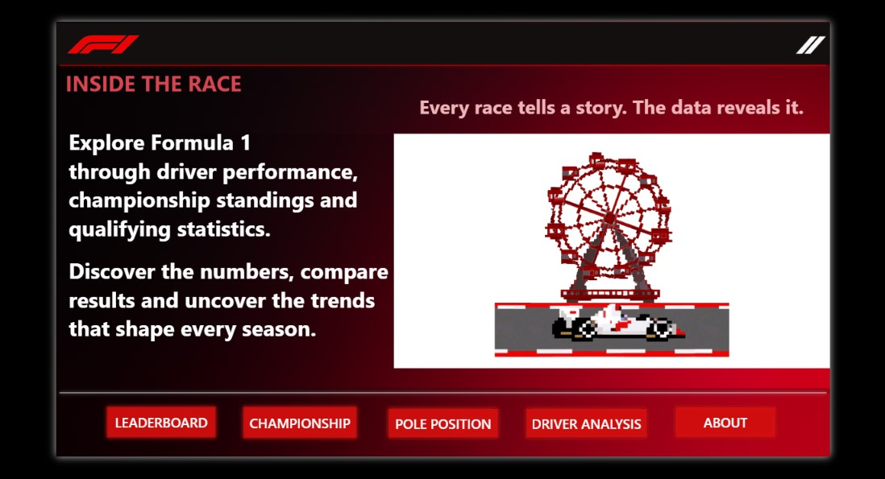
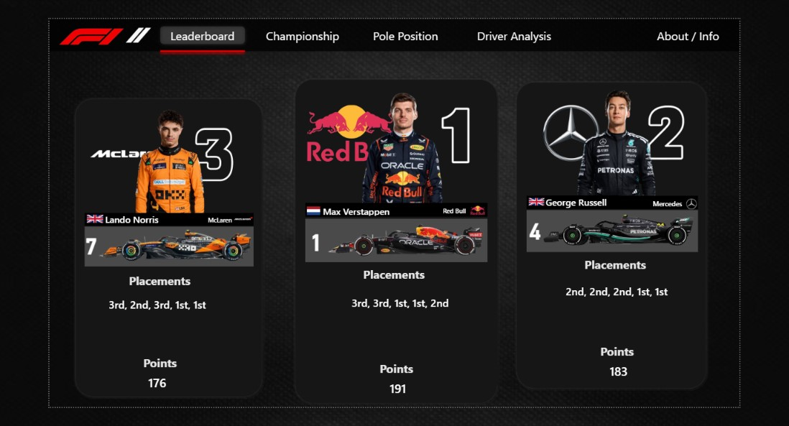
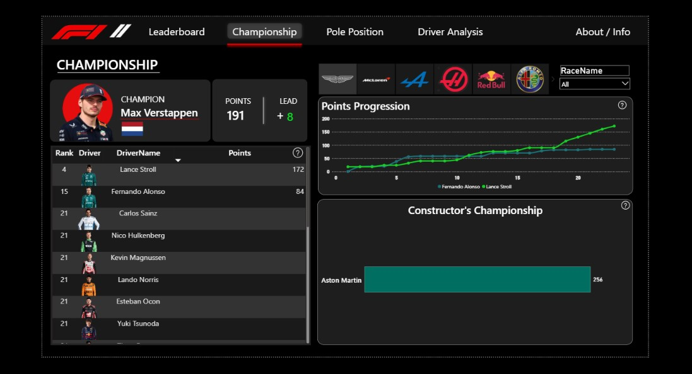
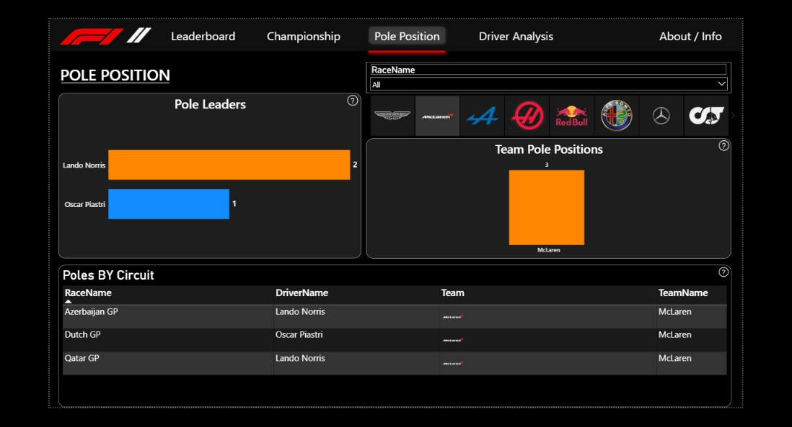
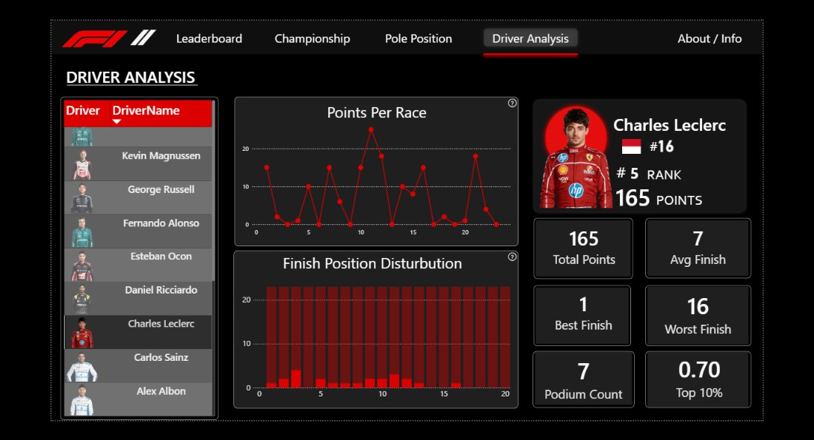
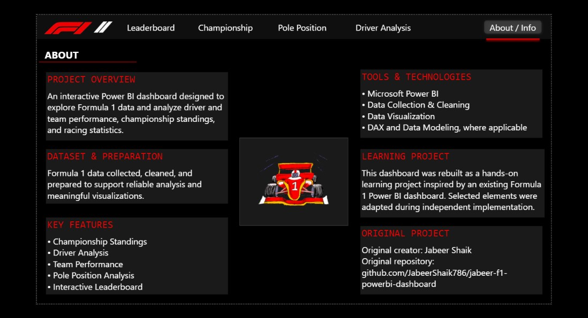

# Tableau de Bord Analytique — Formula 1

<p align="center">
  
  
</p>

<p align="center">
  <strong>Explorer les données au cœur de la course.</strong>
  <br>
  Performance des pilotes · Classements du championnat · Statistiques des qualifications
</p>

<p align="center">
  <strong>Français</strong> &nbsp; | &nbsp; <a href="README.md">English</a>
</p>

---

## Aperçu du tableau de bord

<p align="center">
  
</p>

## Présentation du projet

Ce projet consiste en un **tableau de bord interactif dédié à l'analyse des données de Formula 1, développé avec Microsoft Power BI**. Il transforme les données de course en indicateurs visuels permettant d'explorer les classements des pilotes, les performances en championnat, les résultats des qualifications et les statistiques individuelles.

Le projet combine la collecte et la préparation des données avec des visualisations interactives, une navigation personnalisée et une interface inspirée de l'univers de la Formula 1.

## Exploration du tableau de bord

<table>
  <tr>
    <td width="50%" align="center">
      <strong>01 / Classement des pilotes</strong>
      <br><br>
      <a href="assets/leaderboard.jpg">
        
      </a>
      <sub>Classements et comparaison des performances</sub>
    </td>
    <td width="50%" align="center">
      <strong>02 / Championnat</strong>
      <br><br>
      <a href="assets/championship.jpg">
        
      </a>
      <sub>Classements et statistiques du championnat</sub>
    </td>
  </tr>
  <tr>
    <td width="50%" align="center">
      <strong>03 / Pole Position</strong>
      <br><br>
      <a href="assets/pole-position.jpg">
        
      </a>
      <sub>Résultats des qualifications et statistiques des Pole Positions</sub>
    </td>
    <td width="50%" align="center">
      <strong>04 / Analyse des pilotes</strong>
      <br><br>
      <a href="assets/driver-analysis.jpg">
        
      </a>
      <sub>Statistiques individuelles et analyse des performances</sub>
    </td>
  </tr>
</table>

### À propos du projet

<p align="center">
  <a href="assets/about.jpg">
    
  </a>
</p>

## Fonctionnalités du tableau de bord

| Section | Description |
|:--|:--|
| **Accueil** | Interface principale et navigation entre les pages |
| **Classement des pilotes** | Classements et comparaison des performances |
| **Championnat** | Classements et analyse statistique du championnat |
| **Pole Position** | Analyse des qualifications et des Pole Positions |
| **Analyse des pilotes** | Statistiques individuelles et comparaison des performances |
| **À propos** | Présentation du projet, informations sur les données et crédits |

## Préparation des données

Les données utilisées dans ce projet ont été collectées et préparées indépendamment pour les besoins de l'analyse. Le processus comprend l'organisation, le nettoyage et la structuration des données afin de faciliter leur exploitation et la création de visualisations pertinentes.

## Technologies utilisées

<p align="center">
  
  
  
</p>

| Technologie | Utilisation |
|:--|:--|
| **Microsoft Power BI** | Création de tableaux de bord interactifs et visualisation des données |
| **Power Query** | Nettoyage et transformation des données |
| **Jeu de données Formula 1** | Données statistiques utilisées pour l'analyse des courses |

## Objectifs du projet

- Analyser les statistiques des courses et les résultats des championnats.
- Comparer les performances des pilotes à l'aide de visualisations interactives.
- Explorer les résultats des qualifications et les classements.
- Mettre en pratique les techniques de préparation des données et de Business Intelligence.
- Concevoir un tableau de bord cohérent avec une navigation interactive.

## Structure du dépôt

```text
Formula1Dash/
├── assets/
│   ├── dashboard-home.jpg
│   ├── leaderboard.jpg
│   ├── championship.jpg
│   ├── pole-position.jpg
│   ├── driver-analysis.jpg
│   └── about.jpg
├── Formula1Dash.pbix
├── README.md
└── README.fr.md
```

## Installation et utilisation

1. Cloner ou télécharger ce dépôt GitHub.
2. Ouvrir le fichier `Formula1Dash.pbix` avec Microsoft Power BI Desktop.
3. Naviguer entre les différentes pages pour explorer les visualisations disponibles.

## Inspiration et crédits

Ce projet a été inspiré par le tableau de bord Formula 1 développé par **Jabeer Shaik**.

**Dépôt original :** [jabeer-f1-powerbi-dashboard](https://github.com/JabeerShaik786/jabeer-f1-powerbi-dashboard)

Le projet original a servi de référence durant le développement. Certains concepts et éléments visuels ont été adaptés, avec un travail complémentaire sur la mise en page, les boutons de navigation et les composants du tableau de bord, ainsi qu'une collecte et une préparation indépendantes des données.

Veuillez consulter la licence du dépôt original avant toute redistribution ou réutilisation de ses ressources.

---

<p align="center">
  
  <br><br>
  <sub>Développé avec Microsoft Power BI · Analyse des données du sport automobile</sub>
</p>
