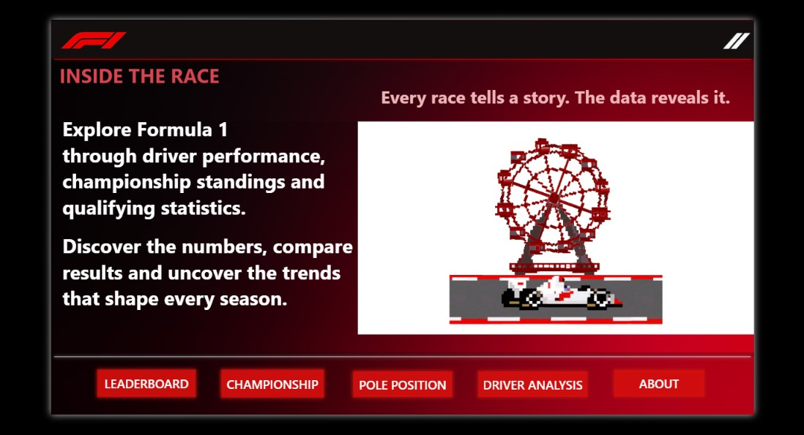
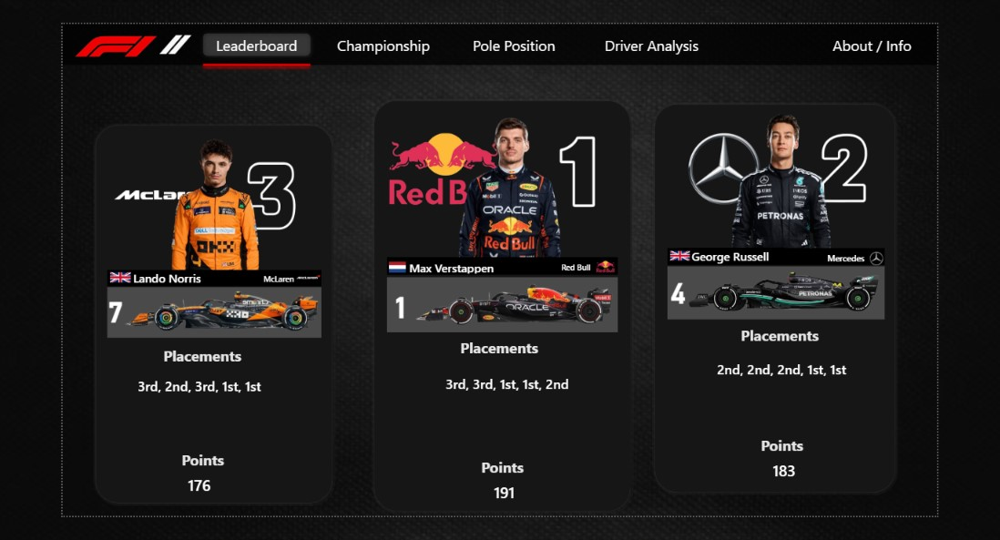
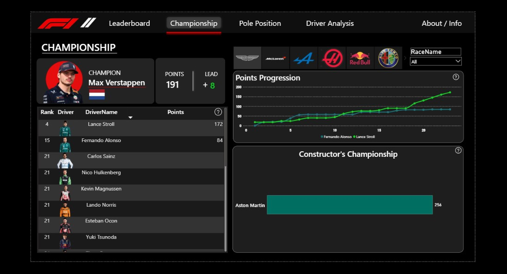
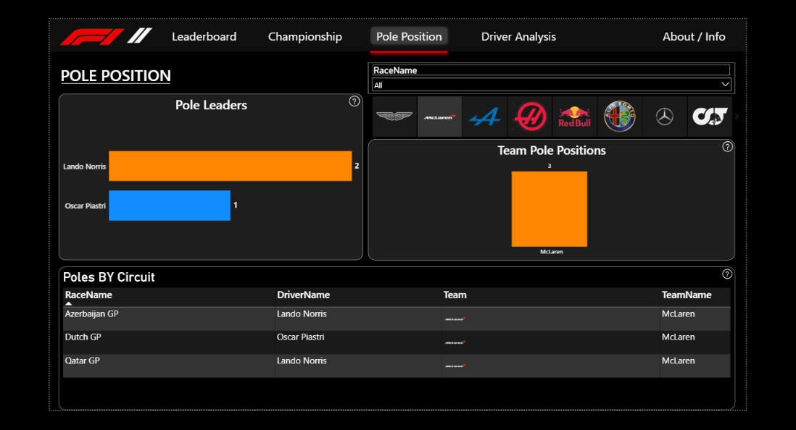
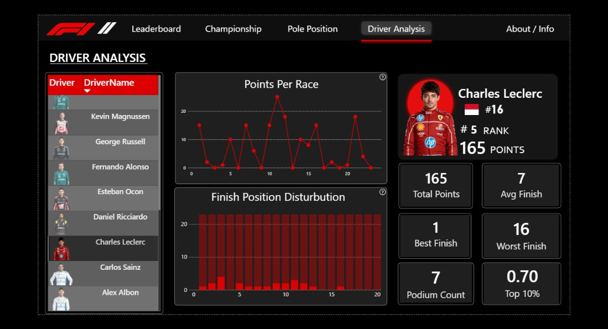
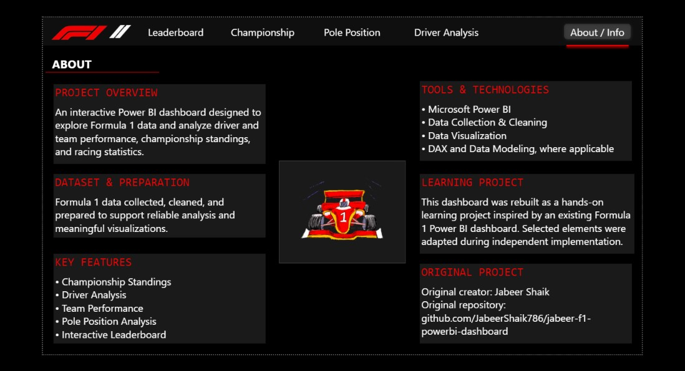

# Formula 1 Analytics Dashboard

<p align="center">
  
  
</p>

<p align="center">
  <strong>Explore the data behind the race.</strong>
  <br>
  Driver performance · Championship standings · Qualifying statistics
</p>

<p align="center">
  <a href="README.fr.md">Français</a> &nbsp; | &nbsp; <strong>English</strong>
</p>

---

## Dashboard Preview

<p align="center">
  
</p>

## Project Overview

This project is an interactive **Formula 1 analytics dashboard developed with Microsoft Power BI**. It transforms racing data into meaningful visual insights, allowing users to explore driver rankings, championship performance, qualifying achievements, and individual statistics.

The project combines data collection and preparation with interactive visualizations, custom navigation, and a Formula 1-inspired interface.

## Explore the Dashboard

<table>
  <tr>
    <td width="50%" align="center">
      <strong>01 / Leaderboard</strong>
      <br><br>
      <a href="assets/leaderboard.jpg">
        
      </a>
      <sub>Driver rankings and performance comparisons</sub>
    </td>
    <td width="50%" align="center">
      <strong>02 / Championship</strong>
      <br><br>
      <a href="assets/championship.jpg">
        
      </a>
      <sub>Championship standings and statistics</sub>
    </td>
  </tr>
  <tr>
    <td width="50%" align="center">
      <strong>03 / Pole Position</strong>
      <br><br>
      <a href="assets/pole-position.jpg">
        
      </a>
      <sub>Qualifying results and pole position analysis</sub>
    </td>
    <td width="50%" align="center">
      <strong>04 / Driver Analysis</strong>
      <br><br>
      <a href="assets/driver-analysis.jpg">
        
      </a>
      <sub>Individual driver statistics and insights</sub>
    </td>
  </tr>
</table>

### About the Project

<p align="center">
  <a href="assets/about.jpg">
    
  </a>
</p>

## Dashboard Features

| Dashboard Section | Key Insights |
|:--|:--|
| **Home** | Main interface and navigation between dashboard pages |
| **Leaderboard** | Driver rankings and performance comparisons |
| **Championship** | Championship standings and statistical analysis |
| **Pole Position** | Qualifying achievements and pole position statistics |
| **Driver Analysis** | Individual driver performance and comparisons |
| **About** | Project background, dataset information, and acknowledgements |

## Data Preparation

The data was independently collected and prepared for analysis. The preparation process involved organizing, cleaning, and structuring the data to make it suitable for visualization and performance analysis.

## Technology Stack

<p align="center">
  
  
  
</p>

| Technology | Purpose |
|:--|:--|
| **Microsoft Power BI** | Interactive dashboards and data visualization |
| **Power Query** | Data cleaning and transformation |
| **Formula 1 Dataset** | Racing statistics and analytical data |

## Project Objectives

- Analyze Formula 1 racing statistics and championship results.
- Compare driver performance through interactive visuals.
- Explore qualifying achievements and driver rankings.
- Apply data preparation and business intelligence techniques.
- Design a consistent dashboard with interactive navigation.

## Repository Structure

```text
Formula1Dash/
├── assets/
│   ├── dashboard-home.jpg
│   ├── leaderboard.jpg
│   ├── championship.jpg
│   ├── pole-position.jpg
│   ├── driver-analysis.jpg
│   └── about.jpg
├── Formula1Dash.pbix
├── README.md
└── README.fr.md
```

## Getting Started

1. Clone or download this repository.
2. Open `Formula1Dash.pbix` using Microsoft Power BI Desktop.
3. Navigate through the dashboard pages to explore the available visualizations.

## Inspiration & Credits

This project was inspired by the Formula 1 Power BI dashboard created by **Jabeer Shaik**.

**Original repository:** [jabeer-f1-powerbi-dashboard](https://github.com/JabeerShaik786/jabeer-f1-powerbi-dashboard)

The original project served as a reference during development. Selected ideas and visual elements were adapted, while additional work was carried out on dashboard layout, navigation buttons, visual components, and independent data collection and preparation.

Please consult the original repository's license before redistributing or reusing its materials.

---

<p align="center">
  
  <br><br>
  <sub>Built with Microsoft Power BI · Data-driven motorsport analysis</sub>
</p>
